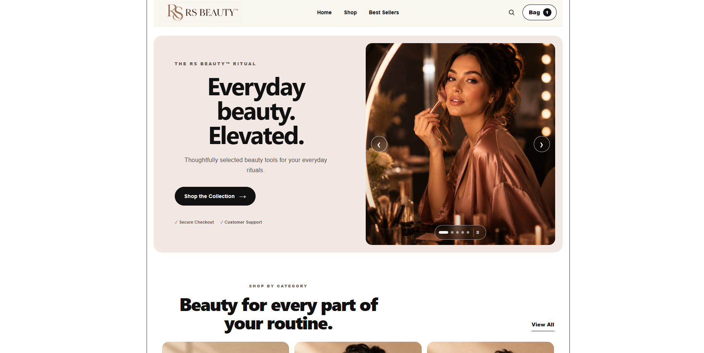
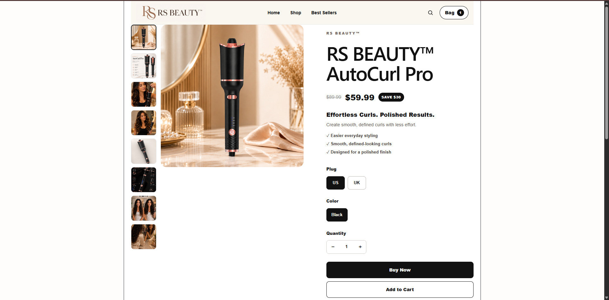
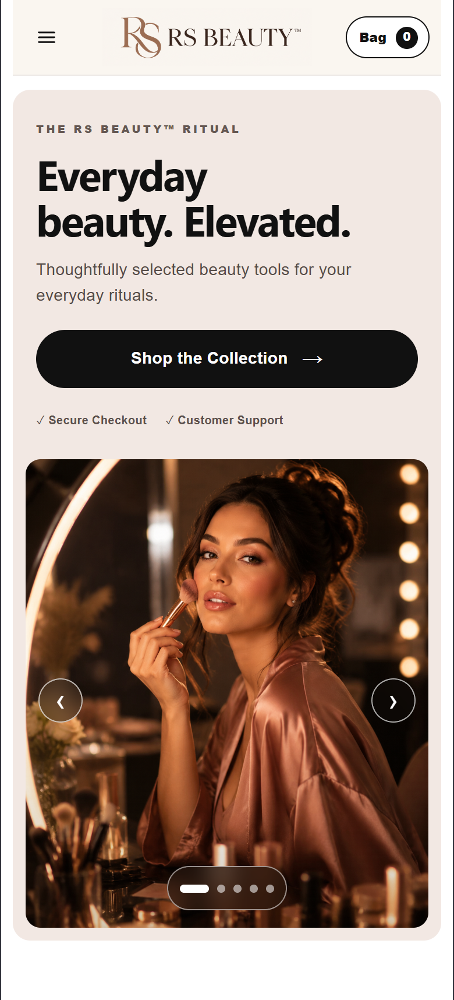

# RS BEAUTY™ Storefront

## 🌐 Live Demo

Responsive e-commerce storefront developed with React and JavaScript, focused on modern UI, mobile-first design and a smooth shopping experience.

## 🚀 Project Overview
RS BEAUTY™ is a beauty e-commerce project created to practice and demonstrate front-end development skills through a real-world storefront.

The project includes product pages, responsive navigation, shopping cart functionality, product variants, mobile layouts and integration with Wix Headless services.
## 📸 Project Preview

### Desktop

### Product Page

### Mobile

  

## 🛠️ Technologies

- React
- JavaScript
- HTML5
- CSS3
- Vite
- Wix Headless
- Git / GitHub
- Responsive Web Design

## ✨ Main Features

- Responsive mobile-first interface
- Product catalog
- Product detail pages
- Shopping cart
- Product variant selection
- Quantity controls
- Responsive navigation
- Mobile menu
- E-commerce UI components
- Wix Headless integration
- Environment variable configuration

## 📱 Responsive Design

The storefront was developed to work across desktop and mobile devices, with special attention to usability, layout consistency and navigation.

## 🔐 Environment Variables

This project uses environment variables for Wix configuration.

Create a local `.env` file based on the `.env.example` file and provide your own credentials.

Sensitive credentials are not included in this repository.

## 👨‍💻 Developer

**Luan Gabriel Campos de Britto**

Front-End Developer focused on React, JavaScript and responsive web development.

LinkedIn:  
https://www.linkedin.com/in/luangabrielcamposdebritto

## 📌 Status

Project under continuous development and improvement.
